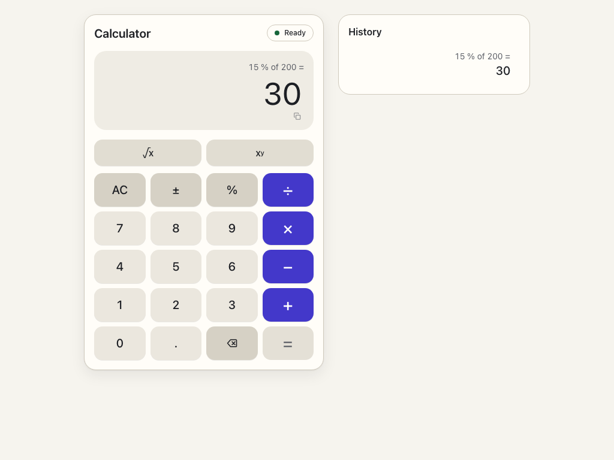

# Calculator

A full-stack calculator: a Go REST API that performs the arithmetic and a React frontend that calls it.

[](https://github.com/gartox/sezzle-calculator/actions/workflows/ci.yml)



## What it does

Seven operations: add, subtract, multiply, divide, power, square root and percent, each validated on both sides and computed by the API.

Stack: Go 1.26.10 standard library for the API, React 19 with TypeScript and Vite for the UI (Node 24 or newer), Storybook for the component library, Playwright for end-to-end tests, Docker for packaging.

## The UI

A keypad calculator in the layout people already know from their phone: four columns, the operators in the accent color down the right, equals in the bottom right corner with backspace beside it. A function row above the keypad holds `√x`, `xʸ` and, on phones, the History toggle.

- **Display.** The expression stays visible above the value (`15 % of 200 =`), so you can check what you typed. Values get thousands separators, a real minus sign and, when they are too long to fit, `× 10` exponents. Clicking the value copies it.
- **Left to right.** Like a basic handheld calculator, each operator calculates what is already complete: `2 + 3 × 4 =` is `(2 + 3) × 4 = 20`, and pressing `×` already shows the intermediate `5`. Every step is one API call, so the UI never does arithmetic itself.
- **Percent and square root.** `15 % 200 =` reads "15 % of 200" and gives `30`. `√x` works on the current value straight away; after an operator it becomes the right operand.
- **States.** The header pill shows Ready or Offline from the health endpoint. Equals looks inactive until there is something to calculate, and shows a busy spinner only if an answer takes longer than 300 ms. An error replaces the value with the API's message and a short `Ref` (the request ID, copied in full on click); the expression stays visible and any key starts over.
- **History.** The last ten results, kept in `sessionStorage` for the tab only (the calculator still works if storage is blocked). Choosing one puts its result back. From 900 px the panel sits beside the calculator; on phones it opens as a sheet.
- **Accessibility.** Every key has an accessible name, the active operator is marked with `aria-pressed` and an outline, results are announced politely, both themes meet WCAG AA contrast, and motion is reduced when the system asks for it.

Keyboard shortcuts, with the matching on-screen key briefly shown as pressed:

| Key | Action |
|---|---|
| `0`–`9` | digits |
| `.` or `,` | decimal point |
| `+` `-` `*` (or `x`) `/` | add, subtract, multiply, divide |
| `^` | power |
| `%` | percent of |
| `r` | square root |
| `n` | toggle the sign |
| Enter or `=` | equals |
| Backspace | delete the last digit |
| Escape | clear all, or close the history sheet |

The reasoning behind the layout, the references it draws on and the visual identity are in [docs/design.md](docs/design.md).

## Scope

The assignment asked for a calculator, unit tests with coverage, this README, the prompts used, and optionally a Dockerfile. All of that is here:

- **Required.** The Go API with seven operations and edge-case handling, the React UI with input rules and basic mobile support, unit tests and committed coverage reports for both layers, this README, [PROMPTS.md](PROMPTS.md), and a Dockerfile with Compose.

Beyond that, each addition answers a question a payments company asks before trusting a service:

- **End-to-end tests.** Unit tests cannot show that the built UI, the binary and the container work together; Playwright checks that on every change.
- **Security hardening and scanning.** Strict input decoding, response headers, a non-root distroless image and dependency, standard-library and image scans in CI, because a vulnerable dependency or a permissive parser is a finding in any audit.
- **OpenAPI with generated types.** One contract that the server serves, the frontend types are generated from and a test holds the Go code to, so client and server cannot drift silently.
- **Rate limiting.** A public endpoint without a limit is the first thing abuse finds; a per-IP token bucket is the smallest useful protection.
- **Request IDs and an access log.** When a customer reports a failure, support needs to find that exact request; the ID in the error shown to the user makes that possible.
- **CI and image publishing.** Every pull request runs lint, format, tests, scans and the image build, and `main` publishes the image, so what is reviewed is what ships.

Two further extras are deliberate, and are about the UI rather than the service:

- **A small design system.** Tokens for color, spacing, type and motion, and components built from atoms up to the page. A calculator needs only a few screens, but a consistent set of parts is what lets a UI change without breaking contrast, focus or spacing somewhere else.
- **Storybook.** Every component and state can be reviewed in isolation, in both themes, and every story runs as a browser test with an accessibility check. It replaces screenshots in a review with something a reviewer can click.

## Quick start

All commands run from the repository root. The three options are independent; pick one.

### Docker

Prerequisites: Docker Engine with Compose v2.

```bash
docker compose up --build
```

Open http://localhost:8080. Stop with `Ctrl+C`, then `docker compose down`.

The same image without Compose:

```bash
docker build -t sezzle-calculator .
```

```bash
docker run --rm -p 8080:8080 sezzle-calculator
```

### Local build

Prerequisites: Go 1.26.10 or newer and Node 24 or newer (`.nvmrc` selects 24). `backend/go.mod` requires Go 1.26.10; an older Go 1.26 release would have to download that toolchain first.

```bash
make run
```

This installs the frontend dependencies, builds the bundle into `frontend/dist`, compiles the server into `bin/server` and starts it. Open http://localhost:8080. Stop with `Ctrl+C`.

### Development with hot reload

Prerequisites: Go 1.26.10 or newer and Node 24 or newer.

Terminal one, the API:

```bash
cd backend && go run ./cmd/server
```

Terminal two, the UI:

```bash
cd frontend && npm ci && npm run dev
```

Open http://localhost:5173. The Vite dev server proxies every `/api` request to the Go server on port 8080, so the browser stays same-origin and no CORS setup is needed. The Go server logs that no frontend build was found and serves the API only; that is expected here, Vite serves the UI.

### Deploy

CI publishes the image to GitHub Container Registry on every push to `main`, once all the other jobs have passed. It publishes the exact image it built, smoke tested and scanned, not a rebuild. Each image gets two tags:

- **The commit SHA, for example `ghcr.io/gartox/sezzle-calculator:3f9c2a7…`.** It is never overwritten. `scripts/publish.sh` asks the registry's OCI distribution API directly whether the tag exists, using a pull token from the workflow's `GITHUB_TOKEN`; it does not trust `docker manifest inspect`, whose "no such manifest" can follow an authorization error. Only `200` counts as present, read with its `Docker-Content-Digest`. Only a `404` whose error code is `MANIFEST_UNKNOWN` counts as absent and allows the push. Every other answer fails the job before anything is pushed: `401`, `403`, `429`, `5xx`, a timeout, or a `404` with another code. Credentials and tokens go to curl on stdin, never on the command line or in the log.
- **`latest`.** Promotion is a separate step. It resolves the digest the commit tag points at from the registry and moves `latest` to that digest, but only while the commit is still the head of `main`. Ordering between concurrent runs is enforced by two things together: the workflow's concurrency group, which runs publishes on `main` one at a time, and that head check, which keeps an older run from moving `latest` backwards. The head check is what `scripts/publish_test.sh` proves, in its "not head" case. If promotion fails, for example on a failed push of `latest`, a rerun finds the commit tag already published and finishes the promotion.

Deployments should pin the digest, which the `publish` job prints in its summary, or the commit tag; `latest` is for trying the image out:

```bash
docker pull ghcr.io/gartox/sezzle-calculator:latest
```

```bash
docker run --rm -p 8080:8080 ghcr.io/gartox/sezzle-calculator:latest
```

Open http://localhost:8080. For a deployment, use `ghcr.io/gartox/sezzle-calculator@sha256:<digest>` instead of `:latest`.

## Project layout

```
.
├── backend/                  Go module, standard library only
│   ├── cmd/server/           entrypoint: config, graceful shutdown, serves the UI
│   ├── cmd/healthcheck/      tiny probe used as the container health check
│   └── internal/
│       ├── calculator/       pure arithmetic and rounding, no HTTP
│       └── httpapi/          JSON handler, OpenAPI document, request IDs, access log, rate limit
├── frontend/                 React 19 + TypeScript + Vite
│   └── src/
│       ├── api/              typed client, health check, types generated from the OpenAPI document
│       ├── calculator/       keypad reducer (pure), history, the hooks that connect them to the API
│       ├── design/           tokens and the Foundations page
│       └── components/       atoms, molecules, organisms, template and page, each with stories
├── e2e/                      Playwright tests (browser and API) against the real stack
├── docs/api.http             ready-to-run requests for the VS Code and JetBrains HTTP clients
├── docs/design.md            UI design rationale; docs/design/ holds the component screenshots
├── .github/workflows/ci.yml  lint, tests, scans, image build and publish
├── Dockerfile                multi-stage build, distroless runtime image
├── docker-compose.yml        one service with a health check
├── Makefile                  run `make` to list the targets
└── PROMPTS.md
```

## API

One endpoint performs every operation. The contract is an OpenAPI 3.1 document, [backend/internal/httpapi/openapi.yaml](backend/internal/httpapi/openapi.yaml), embedded in the binary and served at `GET /api/v1/openapi.yaml`. It lives inside the Go package because `go:embed` can only read files there; it is the only copy. The frontend's request, response and error types in `frontend/src/api/schema.d.ts` are generated from it with `npm run generate:api`, a Go test fails if its enums disagree with the handler's error codes or the calculator's operations, and CI fails if the generated types are stale.

```
POST /api/v1/calculate
Content-Type: application/json
```

Request:

```json
{"operation": "add", "a": 2, "b": 3}
```

Success, `200 OK`:

```json
{"result": 5}
```

`operation` is one of `add`, `subtract`, `multiply`, `divide`, `power`, `sqrt`, `percent`. `a` and `b` are JSON numbers. `sqrt` uses only `a`; the other six need both.

Every error has the same shape, `{"error": {"code": "...", "message": "...", "requestId": "..."}}`. The code is stable and meant for clients; the message is for people; the request ID identifies the request in the server log (see [Observability](#observability)).

| Code | Status | When |
|---|---|---|
| `INVALID_JSON` | 400 | The body is not a JSON object, has a wrong type (for example `"a": "2"`), repeats a key, is empty, has data after the object, or exceeds 1 MiB. |
| `INVALID_OPERATION` | 400 | `operation` is missing or not exactly one of the seven: names are lowercase and are not trimmed, so `ADD` and `" add "` are rejected. |
| `INVALID_OPERAND` | 400 | `a` is missing, or `b` is missing for a two-operand operation; or an operand literal does not fit a 64-bit float: too large (`1e999`, which would become infinity) or nonzero and too small (`1e-999`, which would round to zero, so `1 / 1e-999` is this error rather than `DIVISION_BY_ZERO`). The calculator package also rejects NaN and infinite operands on its own, though JSON cannot carry them. |
| `DIVISION_BY_ZERO` | 422 | `divide` with `b` equal to 0. |
| `NEGATIVE_SQRT` | 422 | `sqrt` with `a` below 0. |
| `RESULT_OVERFLOW` | 422 | The result is not a finite number: `1e308 * 10`, `0 ^ -1`, `(-8) ^ 0.5`. |
| `METHOD_NOT_ALLOWED` | 405 | Any method other than POST on the endpoint (an `Allow` header lists the right one). |
| `UNSUPPORTED_MEDIA_TYPE` | 415 | The request's `Content-Type` is not `application/json` (a `charset` parameter is fine). |
| `NOT_FOUND` | 404 | Any other path under `/api/`. |
| `RATE_LIMITED` | 429 | The client sent more calculations than its per-IP limit allows. A `Retry-After` header gives the wait in whole seconds. |

400 means the request is malformed; 422 means it was well formed but the operation cannot be performed.

Health check, used by Docker and Compose:

```
GET /api/v1/health  ->  200 {"status":"ok"}
```

### Rate limiting

`POST /api/v1/calculate` is limited per client IP with a token bucket: by default each client may send 20 requests at once and 10 per second after that. Over the limit the API answers `429 RATE_LIMITED` with `Retry-After`. The health check, the OpenAPI document and the static UI are not limited. A sweep every minute drops buckets that have been idle long enough to refill completely, at least three minutes and longer at slow rates (`burst / rps`). Dropping a bucket therefore never hands a client back requests it had not earned. Memory is also capped: at most `RATE_LIMIT_MAX_CLIENTS` clients (10,000 by default) are tracked. When the table is full, a new client evicts the least recently seen one. The alternative, refusing new clients with `429` while full, would let anyone who fills the table with rotating addresses lock out every new legitimate client. The sweep walks from the least recently seen end and stops at the first recent bucket, so it never scans clients it keeps.

The client IP is the TCP peer address. `X-Forwarded-For` is ignored unless `TRUST_PROXY=true`, because any client can set that header and would otherwise choose its own IP and bypass the limit. Turn it on only behind a reverse proxy that overwrites the header. The limit is per server instance; several replicas would each keep their own buckets.

### Observability

Every response carries an `X-Request-Id` header. A caller may send its own (1 to 64 letters, digits, dashes or underscores) and it is echoed back; anything else is replaced by 32 random hex characters. Error bodies repeat it as `error.requestId`, and the UI shows it in small print under an error so a user can quote it.

The server writes one access log line per request with the request ID, method, path (without the query string), status, duration in milliseconds, bytes written and client IP. Request bodies are never logged. Logs go to standard error as text by default, or as JSON with `LOG_FORMAT=json`:

```json
{"time":"2026-10-20T15:10:36.523224-06:00","level":"INFO","msg":"request","request_id":"readme-example","method":"POST","path":"/api/v1/calculate","status":422,"duration_ms":0.052,"bytes":102,"client_ip":"::1"}
```

### Configuration

The server reads these environment variables:

| Variable | Default | Meaning |
|---|---|---|
| `PORT` | `8080` | Port to listen on. |
| `STATIC_DIR` | `frontend/dist` | Built frontend to serve; when the directory is missing only the API is served. The Docker image sets `/app/frontend/dist`. |
| `RATE_LIMIT_RPS` | `10` | Calculations per second per client IP. `0` disables rate limiting. Must be a finite number; `NaN` and `Inf` are refused at startup. |
| `RATE_LIMIT_BURST` | `20` | Requests a client may send at once before the per-second rate applies. Must be at least 1. |
| `RATE_LIMIT_MAX_CLIENTS` | `10000` | Most clients tracked at once; the least recently seen is forgotten when full. Must be at least 1. |
| `TRUST_PROXY` | unset | `true` takes the client IP from the first `X-Forwarded-For` address. Leave unset unless a proxy sets that header. |
| `LOG_FORMAT` | text | `json` switches all logs to JSON lines. |

### Examples

Start the server first (any of the quick start options), then run these from a second terminal.

Add. The result is rounded to 12 significant digits, so `0.1 + 0.2` is `0.3`:

```bash
curl -s -X POST localhost:8080/api/v1/calculate -H 'Content-Type: application/json' -d '{"operation":"add","a":0.1,"b":0.2}'
```

```json
{"result":0.3}
```

Square root uses only `a`:

```bash
curl -s -X POST localhost:8080/api/v1/calculate -H 'Content-Type: application/json' -d '{"operation":"sqrt","a":16}'
```

```json
{"result":4}
```

Percent is "`a` percent of `b`", so 15% of 200:

```bash
curl -s -X POST localhost:8080/api/v1/calculate -H 'Content-Type: application/json' -d '{"operation":"percent","a":15,"b":200}'
```

```json
{"result":30}
```

Error responses include a request ID. Without an `X-Request-Id` header it is random on every call, so the error examples below send a fixed one to make the output reproducible.

Division by zero, `422`:

```bash
curl -s -X POST localhost:8080/api/v1/calculate -H 'Content-Type: application/json' -H 'X-Request-Id: readme-example' -d '{"operation":"divide","a":1,"b":0}'
```

```json
{"error":{"code":"DIVISION_BY_ZERO","message":"Cannot divide by zero.","requestId":"readme-example"}}
```

Unknown operation, `400`:

```bash
curl -s -X POST localhost:8080/api/v1/calculate -H 'Content-Type: application/json' -H 'X-Request-Id: readme-example' -d '{"operation":"modulo","a":1,"b":2}'
```

```json
{"error":{"code":"INVALID_OPERATION","message":"Unknown operation \"modulo\". Supported operations: add, subtract, multiply, divide, power, sqrt, percent.","requestId":"readme-example"}}
```

Malformed body, `400`:

```bash
curl -s -X POST localhost:8080/api/v1/calculate -H 'Content-Type: application/json' -H 'X-Request-Id: readme-example' -d '{"operation":"add",'
```

```json
{"error":{"code":"INVALID_JSON","message":"Request body must be a JSON object with a string \"operation\" and numeric \"a\" and \"b\".","requestId":"readme-example"}}
```

GET on the endpoint, `405` with `Allow: POST`:

```bash
curl -s -H 'X-Request-Id: readme-example' localhost:8080/api/v1/calculate
```

```json
{"error":{"code":"METHOD_NOT_ALLOWED","message":"Use POST to calculate.","requestId":"readme-example"}}
```

The OpenAPI document:

```bash
curl -s localhost:8080/api/v1/openapi.yaml | head -3
```

```yaml
openapi: 3.1.0
info:
  title: Calculator API
```

The same requests, plus the health check and a custom request ID, are in [docs/api.http](docs/api.http) for the VS Code REST Client extension and the JetBrains HTTP client.

## Tests

### Unit tests

Each layer has its own suite, and the repository's shell scripts have theirs (`make scripts-test`). All of them run with:

```bash
make test
```

Backend (`make backend-test`): table-driven tests in `internal/calculator` for every operation, negative and large numbers, rounding, negative zero, underflow, division by zero, negative square roots, overflow, NaN and infinite operands; `httptest` cases in `internal/httpapi` for the happy path and every error code, including empty, oversized, wrongly typed and non-JSON bodies, repeated and wrongly cased keys, rate limiting under concurrent load, request IDs and the access log. They run with the race detector.

Frontend (`make frontend-test`): Vitest with Testing Library in jsdom. The keypad rules are a pure reducer, so they are table-driven tests: digits and the fifteen-digit limit, the decimal point, sign, backspace, chaining, operator changes, square root alone and as a right operand, errors and recovery, keys ignored while a request is pending, and the keyboard mapping. The API client is tested with a mocked `fetch` for the success path, each error path and the exact request it sends; history storage is tested with storage that throws. Components are tested with fakes passed as props rather than a network mock: the page takes the API client, the health check, the storage and the clipboard as props, with the real ones as defaults. Page tests cover clicking and keyboard-only calculations, chaining with the intermediate result, the busy state at 300 ms with fake timers, errors with their Ref, a network error re-checking health, history reuse and the phone sheet. Every story also runs as a smoke test.

| Layer | Tests | Command |
|---|---|---|
| Backend (Go, with `-race`) | 60 tests, 257 with subtests | `make backend-test` |
| Frontend unit (Vitest, jsdom) | 282 | `make frontend-test` |
| Storybook (Vitest, Chromium, axe in both themes) | 93 stories | `make storybook-test` |
| End-to-end (Playwright) | 6 UI, 12 API, 15 contract | `make e2e` |
| Shell scripts | 165 checks | `make scripts-test` |

### Coverage

```bash
make coverage
```

This writes `backend/coverage.txt` (`go tool cover -func` output) and `frontend/coverage.txt` (the Vitest v8 text table; an lcov report lands in `frontend/coverage/`). Both files are committed so the numbers can be read without running anything.

| Package | Coverage | Note |
|---|---|---|
| `backend/internal/calculator` | 97.6% | The only uncovered branch is an unreachable fallback in `Round`. Percent cases include intermediate overflow, subnormal operands and a genuine overflow. |
| `backend/internal/httpapi` | 100% | Includes operand range checks (`1e-999`, `1e999`), the rate limiter with a fake clock (slow-rate eviction, the client cap, concurrent saturation under `-race`), request IDs, the access log and the OpenAPI enum contract. |
| `backend/cmd/healthcheck` | 57.1% | `check` is fully tested; `main` is not. |
| `backend/cmd/server` | 50.5% | The security headers middleware, the static handler through `os.Root` (traversal, symlinks out of the directory, missing assets, directory requests), the logger and the environment parsing, including `NaN` and `Inf`, are tested. `run` (startup and graceful shutdown) is not; the end-to-end suite and the container smoke test exercise it. |
| `frontend/src` | 100% | Statements, branches, functions and lines, from the jsdom suite alone; stories are excluded and add their own browser tests. |

### End-to-end

Playwright drives the real stack: the Go binary serving the built frontend. Six browser tests use accessible names only: 15 % of 200 by clicking, a calculation with the keyboard alone, division by zero with its message and `Ref`, left-to-right chaining with the intermediate result, the square root, and reusing a history entry. Twelve API tests cover the health endpoint, rounding, each main error code, the `405` with its `Allow` header, a malformed body, the `415` for a non-JSON body, the security headers, request IDs and the OpenAPI endpoint. The suite starts the server with `RATE_LIMIT_RPS=0`; the `429` path is covered by unit tests instead.

A contract suite (`e2e/tests/contract.spec.ts`) checks the OpenAPI document against the running server. It loads the document the server serves and validates representative requests against `CalculateRequest`. A request the schema accepts must not come back `400`, and one it rejects must. Every response body must then match the schema documented for its status. The one rule JSON Schema cannot express, a literal too small or too large for a 64-bit float, is listed as an explicit case. This uses two small dev dependencies in the e2e package only: `ajv`, a JSON Schema 2020-12 validator matching the dialect of OpenAPI 3.1, and `yaml` to parse the document. The Go side stays on the standard library and checks the enums against the code.

Install once (dependencies and Chromium):

```bash
make e2e-install
```

Then:

```bash
make e2e
```

Playwright starts the stack itself on port 8090, rebuilding the frontend bundle and the binary first so it never tests stale code. If something is already listening on 8090, for example the container started with `docker run --rm -p 8090:8080 sezzle-calculator`, the tests run against that instead. The suite is deliberately not part of `make test` so unit tests stay fast.

The screenshot at the top of this README comes from the same stack, at 1024 px after `15 % 200 =`. It is opt-in so ordinary runs never rewrite a committed file:

```bash
make screenshot
```

### Storybook

```bash
make storybook
```

Opens Storybook on http://localhost:6006 with every component in both themes side by side (the toolbar switches to one), the Foundations page with live contrast ratios computed from the tokens, and interaction stories for the page: typing a calculation, chaining, division by zero and keyboard only.

```bash
make storybook-test
```

Runs every story as a test in Chromium through the Vitest addon. Stories with a play function run their interactions, and the accessibility addon fails the run on any axe violation. `make storybook-build` writes the static site to `frontend/storybook-static/`, and `make design-screenshots` rebuilds it and captures the review screenshots in [docs/design/](docs/design/).

### CI

The workflow in `.github/workflows/ci.yml` runs on every push and pull request to `main` with six jobs:

- **`backend`.** gofmt check, `go vet`, and tests with the race detector.
- **`frontend`.** A matrix on Node 24 and 26: `npm ci`, a check that the generated API types match the OpenAPI document, typecheck, lint, format check, tests and build.
- **`e2e`.** Lint, format check and Playwright on Chromium with Node 24, including the contract suite; the HTML report is uploaded on failure.
- **`security`.** `npm audit` in `frontend/` and `e2e/`, and `govulncheck` from `tools/go.mod`.
- **`scripts`.** The repository's own guards. `scripts/check-supply-chain.sh` fails if an action is not pinned to a 40-character SHA, a Dockerfile `FROM` has no digest, or a tool runs at `@latest`. `scripts/check-workflow.sh` fails if the `publish` job loses its concurrency group, stops depending on the job that builds, smoke tests and scans the image, builds an image instead of loading that artifact, or stops passing the verified image ID to `scripts/publish.sh`. `make scripts-test` tests the publish script against fake `curl`, `docker` and `gh`, both checks against fixtures with each violation, and the Makefile gofmt guard.
- **`image`.** Builds the image once, starts it and runs `scripts/smoke-test.sh`. That test checks the exact status and body of three responses: health `200`, a calculation `200` with `30`, and a division by zero `422` with the full envelope. The job then scans that same image with Trivy and hands it on as an artifact with its image ID.
- **`publish`.** Runs on pushes to `main` only, after the others pass. It loads that artifact, checks the image ID and runs `scripts/publish.sh`; see [Deploy](#deploy).

Every action is pinned to a full commit SHA with its version in a comment, and `make lint` runs the same pin and workflow checks. `make smoke`, `make vulncheck` and `make scripts-test` run the CI checks locally; all the shell scripts are POSIX `sh` and pass shellcheck.

## Code style

```bash
make lint
```

```bash
make format
```

```bash
make format-check
```

`lint` runs `gofmt` and `go vet` on the backend and oxlint in `frontend/` and `e2e/`; `format` runs `gofmt -w` and Prettier (`--write`) in both packages; `format-check` fails if either tool would change a file. The shared Prettier configuration is `.prettierrc` at the repository root: no semicolons, single quotes, print width 100, trailing commas. oxlint finds bugs (unused values, hook misuse, unsafe patterns) and Prettier owns formatting, so neither tool has an opinion the other would fight. Both checks run in CI before the tests, so a pull request with lint or formatting violations fails fast.

## Design decisions

**One endpoint with an operation enum.** `POST /api/v1/calculate` takes the operation as a field. The alternative, one route per operation, means seven handlers with the same decoding and error handling. A single handler validates once and the frontend needs one client function.

**Standard library only.** `net/http`, `encoding/json`, `mime` and `log/slog` cover everything this service needs. Routes are registered by path and each handler checks the method itself, because Go's method patterns answer a wrong method with a plain-text 405 instead of the JSON error envelope. A framework would add a dependency and a learning curve for reviewers without removing any code here.

**A pure calculator package.** `internal/calculator` knows nothing about HTTP: it takes an operation and two floats and returns a result or a sentinel error. `internal/httpapi` only decodes, validates presence, and maps those errors to status codes with `errors.Is`. The arithmetic can be tested with a table and reused by anything else, and the handler tests stay about HTTP.

**Error envelope and the 400 versus 422 split.** Every failure returns `{"error": {"code", "message"}}`, including 404 and 405, which Go's default mux would otherwise answer in plain text. Codes let the frontend react without parsing messages. 400 is reserved for requests the server could not understand; 422 is for well-formed requests whose operation is impossible, so a client can tell a bug in its request from a bad input by the user.

**Numeric precision.** Operands and results are `float64`, and every result is rounded to 12 significant digits before it is returned, so `0.1 + 0.2` is `0.3` and `1 / 3` is `0.333333333333`. For a calculator that is the expected behaviour and the rounding is explicit and tested. Money is a different problem: binary floating point cannot represent most decimal amounts exactly, and rounding errors compound across sums and conversions, so a payments service would use arbitrary-precision decimals (`math/big` or a decimal library) and integer minor units at the boundaries, never floats.

**Semantics of percent, sqrt and power.** `percent(a, b)` is "`a` percent of `b`" (`percent(15, 200)` is `30`), the reading a calculator user expects; the alternative, `a / 100`, needs no second operand and is less useful. `sqrt` uses `a` and ignores `b` so the request shape stays the same for every operation. `power(a, b)` is `a` raised to `b`; a result that is infinite or not a real number (`0 ^ -1`, `(-8) ^ 0.5`) is reported as `RESULT_OVERFLOW` rather than guessed.

**No CORS.** In development Vite proxies `/api` to the Go server, and in production the same binary serves the UI, so the browser never makes a cross-origin request. Enabling CORS would open the API to other origins for no benefit.

**One binary serves the UI and the API.** The server looks for `frontend/dist` (or `STATIC_DIR`) and serves it with an `index.html` fallback. One process, one port and one container keep deployment trivial; a separate web server would only add a hop.

**Distroless image with a Go health probe.** The runtime image is `gcr.io/distroless/static-debian12:nonroot`, which contains the static binary and nothing else: no shell, no package manager, a smaller attack surface and a 14 MB image. Because there is no shell or `curl`, the health check is a second tiny Go binary that requests `/api/v1/health`.

**Playwright for both browser and API end-to-end tests.** One tool and one configuration exercise the real stack from a browser and from its `request` fixture, which keeps the API tests close to the UI tests and the CI job short. The suite reuses a running server, so the same tests validate the Docker image.

## Security

What the service covers:

- **Input.** The body must be declared as `application/json`, otherwise `415`; this also keeps cross-site forms and `text/plain` requests, which browsers send without a CORS preflight, away from the API. The body is capped at 1 MiB with `http.MaxBytesReader`. Keys match exactly and a repeated key is rejected, so a proxy and this server can never read the same body differently. Malformed JSON, wrong types and trailing data are rejected with `INVALID_JSON`. Operands are read as their exact JSON text, so a literal outside the range of a 64-bit float is rejected with `INVALID_OPERAND` instead of silently becoming infinity or zero; unknown fields are ignored. The operation is an exact enum.
- **Server limits.** `ReadHeaderTimeout` 5 s, `ReadTimeout` 10 s, `WriteTimeout` 10 s, `IdleTimeout` 60 s, and a 10 s graceful drain on `SIGINT` and `SIGTERM`.
- **Error responses.** Messages are fixed strings; nothing from the runtime (stack traces, paths, decoder errors) reaches the client. The only input echoed back is the operation name in `INVALID_OPERATION`, JSON-encoded.
- **Static files.** Served only from `STATIC_DIR`, through an `os.Root`, so every lookup is confined to that directory: `..` is refused with `400`, and a symlink that points outside the directory (or uses an absolute target) cannot be opened, so it is treated as missing. Relative symlinks inside the directory work. Unit tests try both a traversal and symlinks to a file and a directory next to `STATIC_DIR`. Unknown paths fall back to `index.html`; unknown paths under `/assets/` are a `404` that is not cached.
- **Response headers.** Every response, including errors and assets, carries `X-Content-Type-Options: nosniff`, `X-Frame-Options: DENY`, `Referrer-Policy: no-referrer`, `Permissions-Policy: camera=(), microphone=(), geolocation=()` and a Content-Security-Policy restricted to this origin (`default-src`, `script-src`, `style-src`, `connect-src`, `img-src` plus `data:`, `frame-ancestors 'none'`, `base-uri 'self'`, `form-action 'self'`). The Vite build emits no inline scripts or styles, so nothing needs `'unsafe-inline'`. `index.html` and the API are `Cache-Control: no-cache`; the hashed files under `/assets/` are `public, max-age=31536000, immutable`.
- **Container.** The runtime image is `gcr.io/distroless/static-debian12:nonroot`: a static binary, no shell, no package manager, running as `nonroot`. The health check is a Go binary for that reason.
- **Secrets.** None are needed and none are tracked; there are no environment files in the repository.
- **Supply chain.** CI fails on high or critical findings from `npm audit` in `frontend/` and `e2e/`, from `govulncheck` on the backend, and from Trivy on the image it publishes (`HIGH,CRITICAL`, unfixed findings ignored). What runs is pinned: actions by commit SHA, `govulncheck` by version in a separate `tools/go.mod` (so the backend module stays dependency-free), and the Dockerfile's base images by digest. Dependabot opens weekly pull requests for all of them, plus npm and Go modules, with minor and patch bumps grouped. `backend/go.mod` pins Go 1.26.10 because `govulncheck` reported standard library issues in `net/http` and `crypto/tls` for 1.26.5 that were fixed in 1.26.9; with 1.26.10 it reports none, and at the time of writing `npm audit` and Trivy report zero findings.

Deliberately out of scope, because they belong to the deployment in front of the service rather than to a calculator:

- Authentication and authorization. Every request is anonymous.
- Rate limiting across instances. The built-in limit (see [Rate limiting](#rate-limiting)) is per process and per IP; shared or per-account quotas belong in a gateway.
- TLS termination. The server speaks plain HTTP on one port; put it behind a reverse proxy or load balancer that terminates TLS.
- Audit trails and log retention. The access log goes to standard error for the platform to collect.

## Assumptions and limitations

- Operands are JSON numbers. Strings and other types are `INVALID_JSON`. Number literals that a 64-bit float cannot hold are `INVALID_OPERAND`: `1e999` would overflow to infinity and `1e-999` would round to zero. Zero itself in any spelling (`0`, `-0`, `0e-999`) and subnormals down to `5e-324` are accepted.
- Results that are infinite or not a number are reported as `RESULT_OVERFLOW` rather than returned.
- Every result is rounded to 12 significant digits, including integers: `9007199254740993 + 0` returns `9007199254740000`. Results that underflow below the smallest double become `0`, and negative zero is returned as `0`.
- Operation names and request keys are exact and lowercase. `ADD`, `" add "` and `"A"` are rejected rather than guessed at.
- No authentication or authorization. Calculations are rate limited per IP and per instance only, and the request body is capped at 1 MiB.
- No persistence: every request is independent and nothing is stored.
- Single instance. The only state is the in-memory rate limit buckets, so several replicas behind a load balancer would work but would each apply the limit separately; nothing here sets that up.

## Prompts

The prompts used while building this project are in [PROMPTS.md](PROMPTS.md), in order, each with a note on what came out of it.
